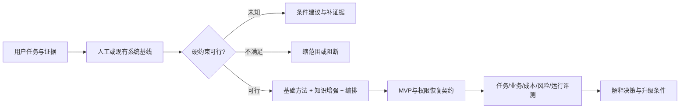

# AI Solution Decision Skill

[](https://github.com/3679qwerr/ai-solution-decision/actions/workflows/ci.yml)

**从业务问题出发，决定何时用规则、RAG、Workflow 或 Agent。**

面向 AI 产品经理的可安装 Agent Skill，包含完整专业知识、可运行计算器、两套模拟产品决策案例与评测工具。关键原则：**不能默认所有产品都需要 Agent。**

| 产品问题 | 本项目的方法 |
|---|---|
| 用户说“做一个 Agent”，真正需要什么？ | 区分用户任务、业务目标、现有替代、证据与假设 |
| 规则、传统算法、检索、LLM 怎么选？ | 先检查硬约束，再选择最小充分技术组合 |
| RAG 与 Workflow 是否冲突？ | 基础方法 × 知识增强 × 编排，分别决策 |
| 怎样证明多 Agent 值得做？ | 独立子任务、净并行收益和冲突控制缺一不可 |
| 方案如何交付与验收？ | MVP、工具与权限、恢复与接管、五类指标和对照 |



## 直接查看

- [安装与使用](ai-solution-decision/README.md) · [Skill 入口](ai-solution-decision/SKILL.md)
- [企业智能营销](ai-solution-decision/examples/enterprise-marketing/output.md)：规则 + RAG + 审批 Workflow。
- [小满桌面伙伴](ai-solution-decision/examples/xiaoman-companion/output.md)：主动交互许可与状态机。
- [源码研究与原创对比](docs/SOURCE_STUDY.md) · [测试结果与局限](docs/TEST_REPORT.md)

**全部案例为模拟。真实业务效果未知，未进行模型 A/B，不将离线通过率解释为产品成功率。**

本地验证：**44/44 项测试、17/17 个确定性门槛回归通过**；文件引用、格式、计算复算与临时目录安装通过。详见 [实际测试报告](docs/TEST_REPORT.md)。

## 运行

Python 3.10+，无第三方运行依赖。在终端进入 `ai-solution-decision` 子目录后运行：

```text
git clone https://github.com/3679qwerr/ai-solution-decision.git
cd ai-solution-decision/ai-solution-decision
python scripts/validate.py
python -m unittest discover -s tests -v
python scripts/eval_runner.py offline
python scripts/cost_model.py --input examples/enterprise-marketing/cost-input.json
```

安装时将整个 `ai-solution-decision` 目录放入宿主指定的 Skill 根目录，或运行其中的 `scripts/install.py --skills-dir <实际根目录>`。安装器拒绝覆盖已有版本。完整的 [安装说明](ai-solution-decision/README.md) 与 [模型对照方案](ai-solution-decision/evals/PROTOCOL.md) 随包提供。

## 工程与产品产物

- 7 项产品决策能力、3 层方案组合、6 维候选比较。
- 成本计算覆盖重试、工具、人工复核、维护、集成、退出和 12/36 月 TCO；不内置报价。
- 20 个评测案例，含 17 个门槛回归与 3 个范围外输入；负触发需要真实模型验证。
- 自动检查包含引用完整性、非 Agent 场景、未知证据、成本边界、指标与权限降级字段、安装与评测器失败测试。
- CI 定义 Windows/Linux 与 Python 3.10/3.12 检查矩阵；本地验证范围见测试报告，发布后的远程运行状态见 [GitHub Actions](https://github.com/3679qwerr/ai-solution-decision/actions/workflows/ci.yml)。

研究借鉴 [Johnson44/skill](https://github.com/Johnson44/skill) 的目录组织与证据方法；改编 **CZ / NativeHelix** 的 [工作流、架构与 Harness 概念](https://github.com/nickzhuchen66/nativehelix)。文档 CC BY 4.0，原创脚本与测试 MIT。详见 [来源署名](ai-solution-decision/ATTRIBUTION.md) 和 [许可证](LICENSE)。参考项目作者未背书本项目。
